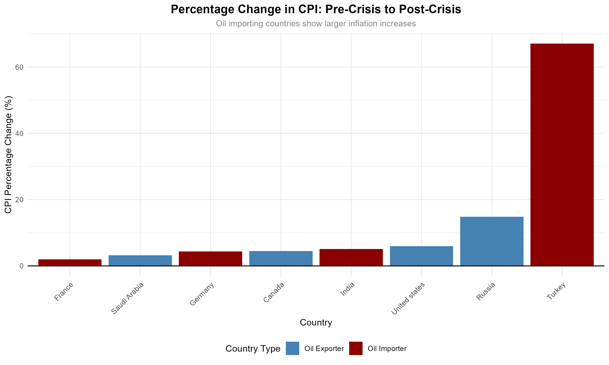
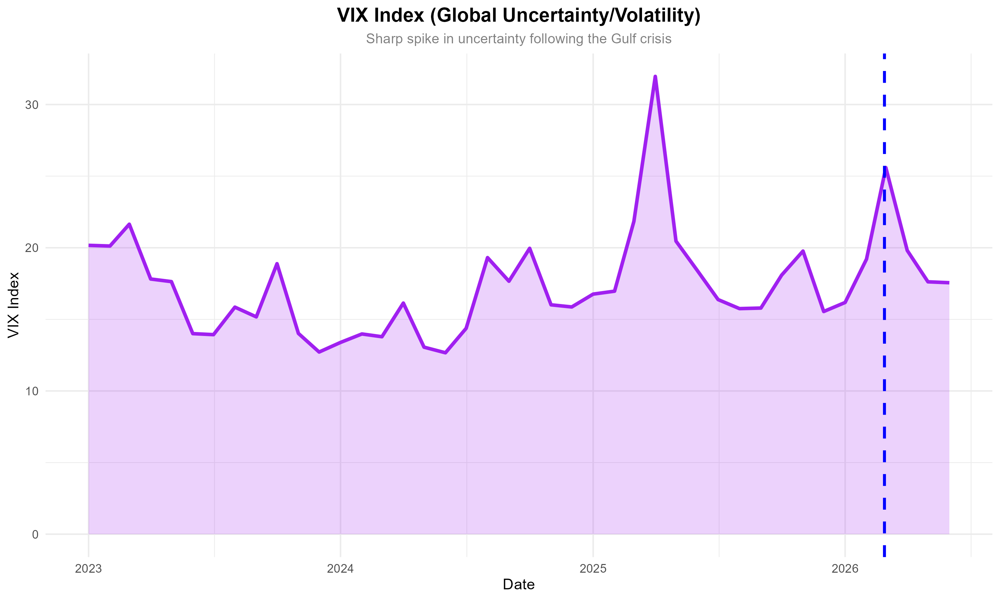

# Geopolitics, Oil Shocks & Inflation — Panel Data Econometric Analysis

## Overview
This project examines how the 2026 Gulf Crisis oil shock transmitted to
inflation across 8 economies, comparing oil importers vs. exporters
using panel data econometrics in R.

## Countries
**Importers:** Germany, France, India, Turkey
**Exporters:** USA, Canada, Saudi Arabia, Russia

## Methods
- Monthly panel data (Jan 2023 – Jun 2026)
- ARIMA forecasting to impute missing trailing observations
- Pooled OLS, Fixed Effects, and Random Effects models (plm package)
- Hausman test, Breusch-Pagan test, HC3 robust standard errors
- Heterogeneity analysis: importers vs. exporters

## Key Findings
- The Gulf crisis significantly increased CPI across affected economies
- Turkey saw up to 67% CPI increase; France only ~2%
- Exchange rate depreciation amplified the oil-to-inflation pass-through
- VIX volatility captured global uncertainty spillovers

## Visualizations

## Tools
R · tidyverse · plm · forecast · lmtest · stargazer · ggplot2
